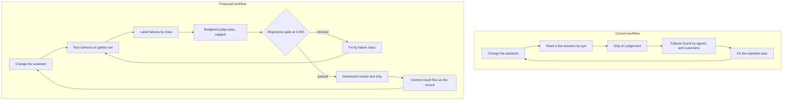

# Process map: evaluation workflow, current and proposed

Part of the enterprise delivery pack for
[rag-eval-harness](https://github.com/JesunAhmadUshno/rag-eval-harness).
Status: illustrative delivery document, 2026-11-15.

**Client scenario (illustrative).** The mid-size firm of the pack's
cover scenario is rolling out a customer-support RAG assistant on a
monthly release cadence. The current workflow below is the typical
manual practice the scenario assumes; it is a scenario description,
not a measured record. The proposed workflow is built entirely from
capabilities that exist and are measured in the source repository.

## 1. Current workflow (as-is)

| Step | Actor | Action | Output | Weakness |
| --- | --- | --- | --- | --- |
| C1 | ML engineer | Change the index, prompts, or corpus | Release candidate | None yet |
| C2 | ML engineer | Read a handful of answers by eye | A feeling about quality | Sample is tiny and chosen by the person who made the change |
| C3 | ML engineer | Ship on judgement | Release | No threshold, no record |
| C4 | Support agents, customers | Hit the failures in live use | Tickets, escalations | The failure is discovered by the people the system serves |
| C5 | ML engineer | Fix the reported case | Hotfix | The class of failure is never counted, so the same class recurs |

## 2. Proposed workflow (to-be)

| Step | Actor | Action | Output | Source capability |
| --- | --- | --- | --- | --- |
| P1 | ML engineer | Change the index, prompts, or corpus | Release candidate | Same as C1 |
| P2 | CI | Run the harness on the golden set: retrieval, answer, lexical metrics on every case | Per-case scores | Level 1 evaluator; pass lines 0.8 / 0.8 / 0.5 |
| P3 | CI | Apply the failure taxonomy to every failing case | Counts by class: hallucination, retrieval_miss, wrong_or_incomplete_answer | Failure taxonomy |
| P4 | CI | Run the budgeted judge pass on a deterministic sample | Judge verdicts inside a hard call cap, with cost accounting | BudgetedJudge: cap, hash-based sampling, calls made and skipped recorded |
| P5 | CI | Apply the regression gate at a 0.900 pass-rate threshold | Gate verdict: pass or block | Regression gate; in the source record it separates 0.719 (fail) from 1.000 (pass) on the Deep set |
| P6 | Support operations lead, ML engineer | Review the run on the dashboard: aggregate, then per-case drill-down on the failing class | Release decision with the failing cases named | Live dashboard, built from the result files |
| P7 | ML engineer | If blocked: fix by failure class (retrieval, answer step, or ranking) and return to P2. If passed: ship | Release, or a targeted fix | The taxonomy routes the fix; in the source record the b11 class pointed at ranking, and the answer-step class pointed at span extraction |
| P8 | CI | Commit the run's result files beside the code that produced them | A permanent, re-derivable record of the decision | Source decision 0003; reproduce.sh fails on byte drift |

## 3. Diagram

## 4. What changes, and the failure each change prevents

| Change | Failure it prevents | Evidence from the source record |
| --- | --- | --- |
| Every case scored, every release (P2) | The unrepresentative spot check | The source system scores 500 and 200 real cases per run; a monthly manual sample cannot match that coverage |
| Failures counted by class (P3) | Fixing instances while the class survives | The b11 class was 13 of 32 Deep cases; counted as a class, it got a targeted fix (5 of 13 to 13 of 13 on that set) |
| A gate with a line (P5) | Shipping a regression because the demo looked fine | The gate at 0.900 fails the unreranked Deep configuration at 0.719 and passes the reranked one at 1.000 |
| Judge spend capped (P4) | Evaluation cost growing silently with the golden set | The cap is enforced in code; the Build run made 10 calls under a cap of 10 and recorded 10 skipped |
| Results committed (P8) | Release decisions that cannot be re-derived later | reproduce.sh regenerates the scored results and fails on any byte change; CI runs it on Python 3.11 and 3.12 |

## 5. Cycle time

The harness side of the proposed workflow is not the bottleneck: the
source system reruns its scored sets in a few seconds on CPU
(reproduce.sh, source README). The human time in the loop is the
dashboard review at P6 and any fix at P7. The manual baseline's human
time, and what the proposed workflow does to it, is modelled with
labelled assumptions in docs/05-roi-model.md; no cycle-time figure is
claimed here, because the source repo does not measure the Firm's
review time and this map does not invent one.
