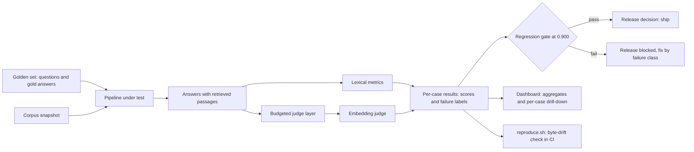

# Solution architecture: RAG evaluation capability

Part of the enterprise delivery pack for
[rag-eval-harness](https://github.com/JesunAhmadUshno/rag-eval-harness).
Status: illustrative delivery document, 2026-11-15.

The architecture below is the source system's own architecture, as
recorded in its README.md, REPORT.md, and docs/decisions/. Where the
illustrative client scenario adds a boundary (the Firm's corpus and
questions), the line is marked as scenario.

## 1. Components

| Component | Responsibility | Source |
| --- | --- | --- |
| Golden sets | Fixed question sets with gold answers: synthetic sets of 8, 20, and 32 cases, and real-data samples of 500 SQuAD and 200 HotpotQA cases | level-1-learn, level-2-build, level-3-deep, real-data |
| Pipeline under test | The reference RAG pipeline being measured: BM25 retrieval over sentences (k1 1.5, b 0.75), extractive answers (whole top sentence, or a span cut by the span extractor), optional stemmed-overlap reranker over the top 5 passages | level-2-build/pipeline.py, level-3-deep |
| Lexical metrics | Faithfulness, context recall, answer relevance, with pass lines 0.8, 0.8, 0.5 | level-1-learn/rag_eval.py |
| Embedding judge | A second scoring signal: embedding similarity and support, thresholds 0.30 and 0.25, over minishlab/potion-base-8M (Model2Vec), on CPU | model-metrics/embedding_judge.py |
| Budgeted judge layer | Wraps any judge with a hard call cap, deterministic sampling (first byte of sha256 of the case id against the sample rate), and public cost accounting | level-2-build/judge.py |
| Failure taxonomy | Labels each failing case: hallucination, retrieval_miss, wrong_or_incomplete_answer | level-3-deep/taxonomy.py |
| Regression gate | Fails the build when the regression set's pass rate falls below 0.900 | level-3-deep/regression_gate.py |
| Result files | One JSON record per run, stored beside the script that writes it; the single source every report and chart reads | Source decision 0003 |
| Dashboard | React app on GitHub Pages: playground, lexical scorer, judge calibrator, per-case browser over the 700 recorded real questions | site/, deployed by a Pages workflow |
| Reproduction check | Regenerates every scored result from the committed evidence and fails on any byte drift; the dashboard build likewise fails unless its JavaScript ports reproduce the Python results | reproduce.sh; site build check |

## 2. Data flow

## 3. Trust boundaries

- TB-1, offline core. The harness runs offline on the Python standard
  library. The only network actions in the source system are fetching
  the public dataset samples and a one-time download of the public
  embedding model. No credential is stored in the repository and none
  is needed to run it (source SECURITY.md).
- TB-2, evidence boundary. Release decisions read only committed
  result files. The reproduction check and the dashboard build check
  exist to keep that boundary honest: numbers that cannot be
  regenerated from the evidence fail the build.
- TB-3, public surface. The dashboard is a static site. It holds no
  client data and accepts no input that leaves the browser; its
  interactive tools compute over the recorded public runs.
- TB-4, client data (scenario). In the Firm's deployment, the corpus
  snapshot and the golden set stay inside the Firm's environment. What
  crosses the boundary is the evaluation code going in and aggregate
  scores coming out. Support questions can contain personal data, so
  the golden set is scrubbed before use; that control is the Firm's,
  and it is listed as a residual risk in the security review
  (docs/04-security-review.md, R4).

## 4. Deployment shape

- The harness runs as a batch job in CI (in the source repo, GitHub
  Actions on Python 3.11 and 3.12) and on any engineer's machine: CPU
  only, standard library first, the scored sets rerun in a few
  seconds.
- The one external dependency is the embedding judge's model2vec
  package and its one-time model download. The source test suite
  injects a fake embedder, so CI downloads nothing.
- The dashboard deploys as static files to GitHub Pages from the
  source repository's Pages workflow.
- There is no server, no database, and no standing infrastructure to
  operate. Scaling the golden set scales a batch run, not a fleet.

## 5. Decisions, with reasons

| ID | Decision | Reason, as recorded in the source repo |
| --- | --- | --- |
| D1 | Standard library only for the core | Inspectability: a reader can verify the metrics by hand, and there is nothing to install (source decision 0001) |
| D2 | Result files live beside the scripts that write them | The dashboard, the CI checks, and the level READMEs all read them there; one evidence location, no separate results store (source decision 0003) |
| D3 | No reranker change shipped in v1.2 | The candidate hybrid key helped SQuAD and hurt HotpotQA; a change that does not help both datasets does not ship (source decision 0002) |
| D4 | Extractive answers in the reference pipeline | Faithfulness is then 1.000 by construction, which makes the measurement honest about retrieval and ranking; the named cost is that the hallucination metric is unexercised until a generative answer step exists (REPORT.md, threats to validity) |
| D5 | Judge calls are budgeted by design, not by discipline | A hard cap, deterministic sampling, and public accounting make evaluation cost a controlled input to the release process (level-2-build/judge.py) |
| D6 | Judge thresholds ship as checked constants, not fitted values | The calibration sweep pulls opposite ways per answer mode, and a 2-fold fit does not beat the shipped pair on both datasets; the constants (0.30, 0.25) are documented as checked, not fitted (REPORT.md, research review section 5) |
| D7 | Synthetic and real results are labelled and never mixed | The synthetic Deep set is in-distribution (its b11 cases were written after the failure was seen); mixing it with real results would overstate quality (REPORT.md, threats to validity) |

## 6. Known limits that shape the architecture

- Retrieval is BM25 only. There is no dense retrieval baseline, and
  retrieval is the measured ceiling on the multi-hop sample (HotpotQA
  context recall 0.518). A client whose assistant uses dense retrieval
  would evaluate its own pipeline through the same harness shape; the
  reference pipeline here is BM25.
- The judge agreement record is against a gold-derived proxy, partly
  circular, with no human labels. The architecture therefore treats
  judge output as a signal beside the lexical metrics, never as the
  sole gate.
- The agent-scoring track in the source repo runs on five scripted
  toy agents. It proves the scorer, not agent behaviour, and this
  architecture does not offer it as agent evaluation.
